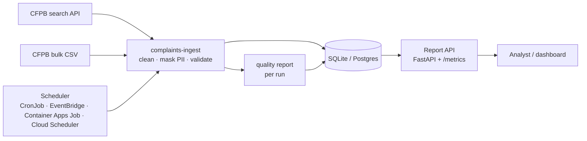

> **Learner starter.** This repo is generated from the reference solution.
> Work through `labs/` week by week and replace each `TODO` until `make exercises` is green
> (`make test` stays green throughout).
> Do not open the reference repo until you have tried each exercise yourself.

# fde-00-programming: complaint-data ingestion service

Phase 0 (weeks 1–4) of the **Forward Deployed ML Engineer: Zero-to-Hired** series. You build the first thing a forward-deployed engineer usually builds at a customer: a dependable pipeline that gets the customer's data out of where it lives, cleans it, and makes it queryable.

**The system:** a typed, tested Python package and CLI (`complaints-ingest`) that pulls consumer complaints from the US CFPB Consumer Complaint Database (public API or bulk CSV), validates, de-duplicates and PII-masks them, stores them in SQLite (local) or Postgres (Compose, Kubernetes, clouds), writes a data-quality report for every run, and serves summaries over a small FastAPI report API. It runs as a **scheduled job** plus the **report API** on Docker Desktop, Podman Desktop, Rancher Desktop, local Kubernetes, OpenShift, AWS, Azure and GCP.

The same complaints data is the flagship banking domain for the whole series: `fde-01` classifies it, `fde-04` fine-tunes on it.



## Quick start (5 minutes, offline)

```bash
python3.12 -m venv .venv && source .venv/bin/activate
make install
make ingest-synthetic        # 5,000 seeded synthetic complaints into artifacts/complaints.db
make report                  # summary in the terminal
make run                     # API on http://127.0.0.1:8000/docs
```

With network access, pull real data instead:

```bash
complaints-ingest ingest-api --days 7 --limit 5000     # CFPB search API
make download-csv && make ingest-csv                   # full bulk CSV (several GB)
complaints-ingest runs                                 # run log with timings
```

## Results

All numbers below were measured by the stated command, on the stated data, on the date shown. Dates are UTC. Raw outputs are committed in [`evals/results/`](evals/results/).

> TODO week-04 results table: complete this section (see labs/).

## Run it everywhere

| Path | Command | What runs |
| --- | --- | --- |
| Local Python | `make install && make e2e` | API on SQLite with 500 synthetic complaints, smoke test |
| Docker Desktop | `make up-docker`, then `make ingest-docker ARGS="ingest-api --days 7"` | Postgres + API (Compose); ingest as a one-off job |
| Podman Desktop | `make up-podman`, then `make ingest-podman` | Postgres + API in one pod (`podman kube play`) |
| Rancher Desktop | `make up-rancher`, then `make ingest-rancher` | Same Compose stack on Rancher's moby engine |
| Local Kubernetes | `make k8s-docker`, `make k8s-rancher`, `make k8s-kind`, then `make k8s-ingest` | API Deployment, Postgres StatefulSet, ingest CronJob (suspended on desktops) |
| OpenShift | `oc apply -k deploy/openshift` | API + CronJob + Route; bring your own Postgres Secret |
| Helm | `helm install complaints deploy/helm/fde-00-programming` | API + CronJob; bring your own Postgres Secret |
| AWS | `make tf-aws-plan` | ECS Fargate API, RDS Postgres, EventBridge Scheduler task |
| Azure | `make tf-azure-plan` | Container Apps API, Postgres Flexible Server, Container Apps Job |
| GCP | `make tf-gcp-plan` | Cloud Run API, Cloud SQL Postgres, Cloud Run job + Cloud Scheduler |

Step-by-step: [desktop labs](docs/learning/DESKTOP-LABS.md), [cloud labs](docs/learning/CLOUD-LABS.md), [deployment](docs/DEPLOYMENT.md). Estimated cloud cost per month: [COST-TCO](docs/COST-TCO.md). `make help` lists every target.

## API

| Endpoint | Returns |
| --- | --- |
| `GET /health/live`, `GET /health/ready` | Liveness; readiness checks the database (503 when it is down) |
| `GET /metrics/` | Prometheus: request counts and latency, `complaints_stored`, `complaints_last_ingest_timestamp_seconds` |
| `GET /api/v1/summary` | Totals, date range, timely-response rate, top products, issues and companies |
| `GET /api/v1/by-month` | Complaints per month |
| `GET /api/v1/complaints` | Search: `product`, `company`, `state`, `received_from`, `received_to`, `limit` (1–500), `offset` |
| `GET /api/v1/runs` | Recent ingest runs with counts and timings |

## Learning path

| Week | Lab | You build |
| --- | --- | --- |
| 0 | [Set up](labs/week-00-setup/README.md) | Toolchain, first run on a desktop engine |
| 1 | [Python basics](labs/week-01-python-basics/README.md) | `normalise_text`, `parse_bool`, `parse_date` |
| 2 | [Python for real work](labs/week-02-python-for-real-work/README.md) | `mask_pii`, `to_complaint` (validation with pydantic) |
| 3 | [Developer tooling](labs/week-03-developer-tooling/README.md) | `null_counts`, tests, lint, CI, a container |
| 4 | [Data handling](labs/week-04-data-handling/README.md) | `parse_page`, `upsert_complaints`, `counts_by_product`, the results table |

**Phase 0 exit check:** from a fresh clone, `make test` and `make e2e` pass, the stack runs on one desktop engine with Postgres, a real CFPB pull is stored and reported, and your README results table holds numbers you measured.

## Repository map

```text
app/main.py               report API (FastAPI, Prometheus)
src/complaints_ingest/    schema, clean, cfpb (API + CSV), store, quality, report, pipeline, cli, synthetic
tests/                    unit, API, CLI, pipeline, Postgres tests; fixtures/; e2e/smoke.yaml
scripts/                  benchmark, smoke_test, make_starter, check_structure, init_repo
evals/results/            committed benchmark outputs behind the results table
labs/                     weeks 0–4
docs/                     architecture, ADRs, customer brief, security, data card, datasets, infra, labs, cost
deploy/                   compose, podman, kubernetes (base + overlays + desktop Postgres), openshift, helm
terraform/                aws, azure, gcp stacks with managed Postgres and a scheduled ingest
monitoring/               Prometheus scrape config, alerts (incl. stale ingest), Grafana dashboard
```

## Reference and starter

[`fde-00-programming`](https://github.com/sundayayandele/fde-00-programming) is the **reference** repo: complete code and measured results. [`fde-00-programming-starter`](https://github.com/sundayayandele/fde-00-programming-starter) is generated from it with `make starter` for learners: each exercise becomes a `NotImplementedError("TODO ...")` stub, exercise tests are marked `@pytest.mark.exercise` (run them with `make exercises`), and the results table is blanked for you to fill in with your own numbers.

## Licence

Code: [MIT](LICENSE). Written content: [CC BY-SA 4.0](LICENSE-CONTENT.md). CFPB complaint data is a US government work published as open data; see [DATASETS](docs/datasets/DATASETS.md) for terms and what to verify.

Part of [fde-zero-to-hired](https://github.com/sundayayandele/fde-zero-to-hired) by Sunday Ayandele.
