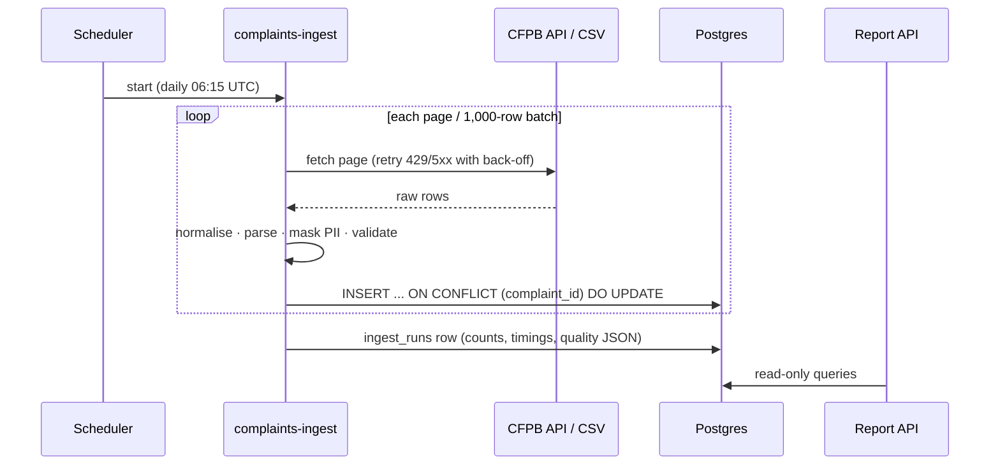

# Architecture

## Purpose

Get complaint records from a public source into a database the team can query, every day, with evidence of data quality for each run. Later phases read this database: `fde-01` trains a classifier on it, `fde-04` builds fine-tuning sets from it.

## Components

| Component | Code | Runs as |
| --- | --- | --- |
| Source readers | `cfpb.py`: `CFPBClient` (search API, paging, retries), `iter_csv` (bulk CSV, streamed) | Inside the ingest job |
| Cleaning and validation | `clean.py`: normalise text, parse booleans and dates, mask PII, map to `Complaint` (pydantic) | Inside the ingest job |
| Storage | `store.py`: SQLAlchemy Core tables `complaints`, `ingest_runs`; one upsert for SQLite and Postgres | SQLite file or Postgres 16 |
| Quality | `quality.py`: `QualityTracker` counters per run (nulls, duplicate IDs, rejection reasons, schema drift, PII masked) | Inside the ingest job; stored as JSON per run |
| Pipeline | `pipeline.py`: batches of 1,000 → clean → upsert → track → run log | Inside the ingest job |
| CLI | `cli.py`: `init-db`, `ingest-api`, `ingest-csv`, `ingest-synthetic`, `report`, `runs` | Laptop, Compose job, CronJob, cloud scheduled task |
| Report API | `app/main.py`: health, metrics, summary, by-month, search, runs | Container (Deployment, Container App, Cloud Run, ECS service) |

One image contains both entry points: `uvicorn app.main:app` for the API and `complaints-ingest` for the job.

## Data flow

## Design choices

| Decision | Record |
| --- | --- |
| SQLite locally, Postgres everywhere else, one code path | [ADR-004](../adr/ADR-004-sqlite-local-postgres-elsewhere.md) |
| Two sources (API for daily deltas, CSV for backfill) mapped to one canonical record | [ADR-005](../adr/ADR-005-cfpb-api-and-bulk-csv.md) |
| Stream in batches; quality counters instead of in-memory lists | [ADR-006](../adr/ADR-006-streaming-batches.md) |
| Mask PII even though CFPB redacts narratives | [ADR-007](../adr/ADR-007-pii-masking-defence-in-depth.md) |
| Same deployment matrix as every series repo | [ADR-003](../adr/ADR-003-deployment-matrix.md) |

## Properties

- **Idempotent.** Re-running an ingest for overlapping dates updates rows in place; the row count does not grow (tested on SQLite and Postgres).
- **Explainable rejections.** Every rejected row has a reason, counted per run.
- **Constant memory.** Peak RSS stayed at 97 MB for a 300,000-row CSV (see README results).
- **Observable.** API metrics plus `complaints_stored` and `complaints_last_ingest_timestamp_seconds`; alerts `IngestStale` and `DatabaseUnreachable`.
- **No LLM calls.** The provider-agnostic client from the template is kept for later phases but not used here.

## Limits

- The CFPB search API's simple paging stops at 10,000 results per query (`MAX_OFFSET`); use narrower date windows or the bulk CSV for backfills.
- The `complaint_id` set used for duplicate counting grows with the run (roughly tens of MB per million rows).
- One writer at a time: the CronJob uses `concurrencyPolicy: Forbid`; cloud schedulers start one task per run.

See [C4 views](C4.md) for context and container diagrams.
