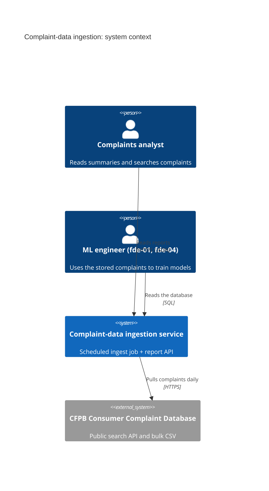
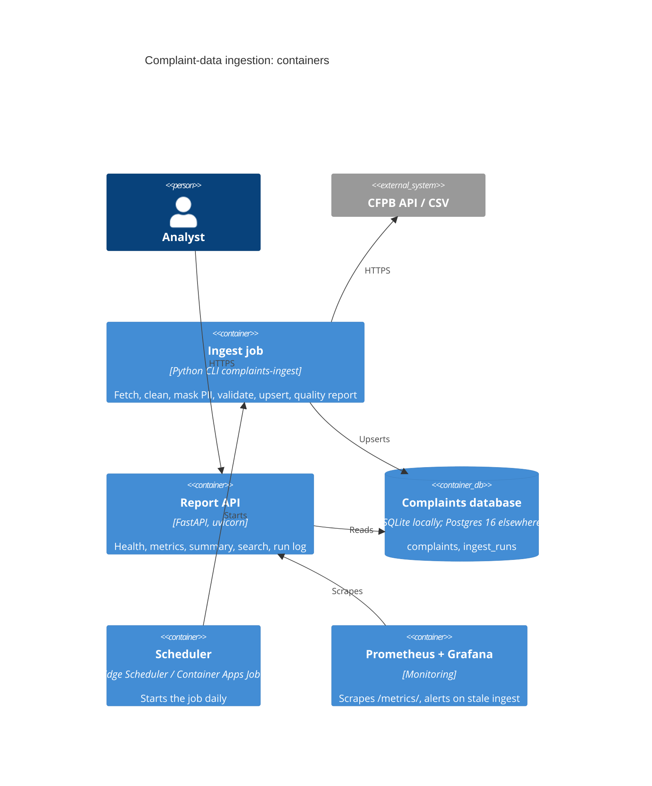

# C4 views

## Level 1: System context

## Level 2: Containers

## Level 3: Components

| Component | Module | Responsibility |
| --- | --- | --- |
| Canonical schema | `schema.py` | `Complaint` model, field maps for API and CSV, required fields |
| Cleaning | `clean.py` | Text, boolean and date parsing; PII masking; row → `Complaint` or rejection reason |
| Source readers | `cfpb.py` | API paging with retries; streamed CSV |
| Storage | `store.py` | Tables, portable upsert, run log |
| Quality | `quality.py` | Per-run counters and report |
| Reports | `report.py` | Aggregations shared by CLI and API |
| Pipeline and CLI | `pipeline.py`, `cli.py` | Batching, timing, commands |
| HTTP layer | `app/main.py` | Routes, validation, metrics, data-freshness gauges |

Diagram sources for the enterprise, logical and technical views are in [`diagrams/source/`](../../diagrams/source/).
